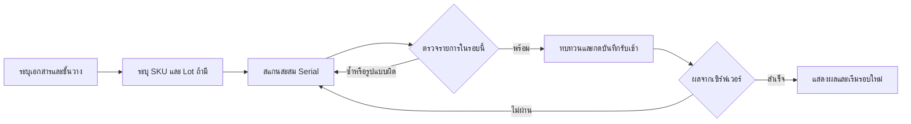

# WMS UX/UI Design Specification — shadcn/ui

เอกสารออกแบบประสบการณ์และหน้าจอระบบบริหารคลังสินค้าในองค์กร สำหรับนำไปพัฒนาในโปรเจกต์ `wms-project-test`

วันที่: 27 ตุลาคม 2026 · ภาษา: ไทย · อุปกรณ์: Desktop, Tablet และ Handheld scanner

สถานะ: พัฒนาหน้าจอจริงระยะแรกแล้วด้วย shadcn/ui ได้แก่ โครงหน้า ภาพรวม ค้นหาสต็อก รับเข้า จ่ายออก และประวัติ Serial ตัวเลขและรหัสในแบบร่างด้านล่างยังเป็นข้อมูลตัวอย่าง ส่วนหน้าจอจริงอ่านข้อมูลจากระบบ

ขอบเขตที่ยังไม่เปิดใช้: งานย้ายสินค้า ตรวจนับ รับคืน สิทธิ์ผู้ใช้ การเลือกคลัง และการค้นหาทั้งชุดเกิน 300 S/N หน้าค้นหาแสดงขอบเขตผลลัพธ์ชัดเจน และตารางเรียง/แบ่งหน้าเฉพาะรายการที่โหลด

## 1. เป้าหมายและขอบเขต

ทำให้เจ้าหน้าที่รู้ว่า “กำลังทำงานกับสินค้าใด อยู่ที่ไหน และบันทึกสำเร็จแล้วหรือยัง” โดยลดการพิมพ์ซ้ำและการหยิบผิดชิ้น

| เป้าหมาย | แนวทาง UX | วิธีตรวจรับ |
| --- | --- | --- |
| ค้นหาสินค้าได้แม้ไม่รู้ S/N | ค้นด้วย SKU ชื่อสินค้า ชั้นวาง Lot หรือเอกสาร | จากผลค้นหาเปิดประวัติ S/N ได้โดยไม่กรอกใหม่ |
| รับเข้าได้ต่อเนื่อง | สแกน S/N สะสมและคงโฟกัส | สแกนหลายชิ้นได้โดยไม่ใช้เมาส์ทุกครั้ง |
| จ่ายออกอย่างเข้าใจผลกระทบ | ตรวจชั้นวางและแสดงสรุปก่อนตัดจ่าย | ผู้ใช้เห็น S/N เอกสาร และผลต่อสต็อกก่อนยืนยัน |
| ลดความสับสนเรื่องยอด | แยกยอดในคลัง ยอดจอง และพร้อมจ่าย | ทุกยอดมีหน่วย ขอบเขต และคำอธิบาย |
| แก้ข้อผิดพลาดได้ | แสดงปัญหาตรงช่องและเก็บข้อมูลเดิม | ไม่ต้องเริ่มงานใหม่เมื่อเกิด validation error |

### 1.1 ฐานโปรเจกต์ก่อนเริ่มปรับหน้าจอ

- Next.js App Router, React, TypeScript, Tailwind CSS 3, Prisma, SQLite และ Zod
- หน้าภาพรวม `/`, ค้นหาสต็อก `/inventory`, รับเข้า `/inbound`, จ่ายออก `/outbound`, ประวัติ `/serials`
- API รับเข้า จ่ายออก ค้นหาสต็อก และตรวจสอบ Serial
- Service ย้ายตำแหน่งสินค้า แต่ยังไม่มีหน้าและ API สำหรับงานย้ายตามโครงสร้างที่ตรวจพบ
- ยังไม่พบ `components.json` และชุดคอมโพเนนต์ shadcn/ui ในโปรเจกต์

### 1.2 ขอบเขตการออกแบบ

**ระยะแรก:** ปรับโครงหน้าหลักและห้าหน้าที่มีอยู่ พร้อมกำหนดพฤติกรรมและส่วนต่อเชื่อมข้อมูลที่จำเป็น

**ระยะถัดไป:** ย้ายสินค้า ตรวจนับ รับคืน ข้อมูลหลัก รายงาน และสิทธิ์ผู้ใช้ เป็นข้อเสนอสำหรับพัฒนาเพิ่ม ไม่เปิดเมนูที่ใช้งานไม่ได้ในเมนูหลักของระยะแรก

การมี enum หรือฟิลด์ในฐานข้อมูลไม่ได้หมายความว่ามี workflow นั้นพร้อมใช้แล้ว

## 2. ผู้ใช้งานและงานหลัก

| กลุ่มผู้ใช้เป้าหมาย | งานหลัก | สิ่งที่หน้าจอต้องให้ความสำคัญ |
| --- | --- | --- |
| เจ้าหน้าที่รับเข้า | ระบุเอกสาร ชั้นวาง SKU และสแกน S/N | จำนวนสแกน รายการซ้ำ และสถานะบันทึก |
| เจ้าหน้าที่จ่ายออก | ตรวจตำแหน่งและจ่ายตาม S/N | ชั้นวางถูกต้อง สถานะสินค้า และเอกสารปลายทาง |
| ผู้ดูแลคลัง | ค้นหา ตรวจยอด และติดตามการเคลื่อนไหว | ตัวกรอง ขอบเขตยอด และประวัติย้อนหลัง |
| หัวหน้าคลัง | ดูสินค้าต่ำกว่าจุดเตือนและข้อยกเว้น | รายการที่ต้องจัดการและข้อมูลที่เชื่อถือได้ |

ตารางนี้ใช้กำหนดความต้องการของหน้าจอ ยังไม่ใช่ระบบสิทธิ์ที่มีอยู่จริง หากเพิ่มบทบาทต้องกำหนดและตรวจสิทธิ์ฝั่งเซิร์ฟเวอร์ด้วย

## 3. โครงสร้างข้อมูลและเมนู

```text
WMS คลังสินค้า
├── ภาพรวม                         /
├── สินค้าคงคลัง                    /inventory
├── รับสินค้าเข้า                    /inbound
├── จ่ายสินค้าออก                   /outbound
└── ประวัติ Serial                  /serials?sn=...

ระยะถัดไป เมื่อมีข้อมูลและ API พร้อม
├── ย้ายสินค้า                      /transfers
├── ตรวจนับ                         /stock-counts
├── รับคืนและกักกัน                   /returns
├── ข้อมูลหลัก                       /master-data
└── รายงาน                          /reports
```

- ไม่ใส่ลำดับเลขนำหน้าเมนู เพราะเมนูเป็นหมวดงาน ไม่ใช่ขั้นตอนบังคับ
- เมนูปัจจุบันใช้พื้นหลังและข้อความที่ต่างจากเมนูอื่น พร้อม `aria-current="page"`
- แสดงชื่อคลังในหัวหน้าจอเสมอ หากยังเลือกคลังผ่าน API ไม่ได้ ให้เป็นข้อความคงที่ ไม่แสดงตัวเลือกที่เปลี่ยนข้อมูลไม่ได้
- ใช้ Breadcrumb เมื่อมีหน้ารายละเอียด เช่น “สินค้าคงคลัง / SCAN-PRO-X1 / SN2610-0004”
- ช่องค้นหาในส่วนหัวระยะแรกนำไปหน้าค้นหาสต็อก ไม่อ้างว่าค้นได้ทุกโมดูล
- เปลี่ยนคลังระหว่างมีรายการสแกนต้องจัดการรายการค้างก่อน ไม่ย้ายบริบทเงียบ ๆ

## 4. แนวทางภาพรวมของหน้าจอ

### 4.1 บุคลิกและลำดับสายตา

รูปแบบ: เรียบ ชัด อ่านง่าย เหมาะกับการทำงานซ้ำ ใช้พื้นหลังสว่างและสีหลักน้ำเงิน ให้รหัสสินค้าและตัวเลขเด่นกว่าของตกแต่ง

ลำดับการอ่านทุกหน้า:

1. ชื่องานและคลังปัจจุบัน
2. สถานะหรือปัญหาที่ต้องจัดการ
3. ช่องกรอกหรือข้อมูลหลัก
4. ผลลัพธ์และรายละเอียดเพิ่มเติม
5. ปุ่มดำเนินการหลัก

ไม่ใช้ข้อความเทคนิค เช่น ชื่อฐานข้อมูล เป็น KPI ในหน้าปฏิบัติงาน

### 4.2 โครงหน้าหลัก

| ส่วนประกอบ | Desktop | Handheld / Mobile |
| --- | --- | --- |
| Sidebar | กว้าง 248 px ย่อเหลือแถบไอคอน 64 px ได้ | เปิดเป็น Sheet ด้วยปุ่มเมนู |
| Header | สูงขั้นต่ำ 64 px มีชื่อคลังและค้นหา | สูงตามเนื้อหา คงชื่อคลังและงานปัจจุบัน |
| Content | ระยะขอบ 24–32 px; หน้าตารางใช้ความกว้างที่เหลือ | ระยะขอบ 16 px ไม่เลื่อนแนวนอนทั้งหน้า |
| หน้าสแกน | เนื้อหากว้างไม่เกิน 1,200 px แบ่ง 8/4 คอลัมน์ | คอลัมน์เดียว ช่องสแกนอยู่ก่อนรายละเอียด |
| แถบปุ่มท้ายงาน | ชิดขอบล่างของพื้นที่งาน | Sticky โดยเผื่อ safe area และพื้นที่คีย์บอร์ด |

### 4.3 สีและ design tokens

ค่าต่อไปนี้เป็นข้อกำหนดดีไซน์ของ WMS ให้เชื่อมกับ semantic tokens ของ shadcn/ui เมื่อพัฒนา โดยใช้แนวคิด background/foreground ตาม [เอกสาร Theming](https://v3.shadcn.com/docs/theming)

| Token / บทบาท | ค่าเป้าหมาย | การใช้ |
| --- | --- | --- |
| `background` | `#F8FAFC` | พื้นหลังพื้นที่ทำงาน |
| `foreground` | `#0F172A` | ข้อความหลัก |
| `card`, `popover` | `#FFFFFF` | การ์ดและชั้นข้อมูลลอย |
| `primary` | `#1D4ED8` | ปุ่มหลักและรายการที่เลือก |
| `primary-foreground` | `#FFFFFF` | ข้อความบนสีหลัก |
| `secondary`, `muted` | `#F1F5F9` | พื้นที่รองและปุ่มรอง |
| `muted-foreground` | `#475569` | คำอธิบายและข้อมูลรอง |
| `border` | `#E2E8F0` | เส้นแบ่งพื้นที่ |
| `input` | `#64748B` | ขอบช่องกรอกที่ต้องมองเห็นชัด |
| `ring` | `#1D4ED8` | เส้นโฟกัส |
| `destructive` | `#B91C1C` | การลบหรือปัญหาที่ต้องแก้ |
| Sidebar | พื้น `#0F172A`, ตัวอักษร `#F8FAFC` | แยกการนำทางออกจากพื้นที่งาน |

สีสถานะใช้พื้นอ่อนและตัวอักษรเข้ม พร้อมไอคอนและข้อความ ไม่ใช้สีอย่างเดียว

| สถานะ | พื้น / ตัวอักษร | ตัวอย่าง |
| --- | --- | --- |
| สำเร็จ / พร้อมใช้งาน | `#ECFDF5` / `#065F46` | “บันทึกแล้ว”, “อยู่ในคลัง” |
| รอ / จอง | `#FFFBEB` / `#92400E` | “จองแล้ว” |
| ผิดพลาด / ชำรุด | `#FEF2F2` / `#991B1B` | “Serial ซ้ำ”, “ชำรุด” |
| ส่งออกแล้ว | `#EFF6FF` / `#1E40AF` | “จ่ายออกแล้ว” |
| ข้อมูลรอง | `#F1F5F9` / `#334155` | “ยังไม่บันทึก” |

### 4.4 ตัวอักษร ระยะ และขนาด

- ใช้ฟอนต์ไทย Sarabun หรือ Noto Sans Thai พร้อม system fallback; รหัสใช้ monospace ที่แยก `0/O` และ `1/I` ได้ง่าย
- หัวหน้า 24–28 px / น้ำหนัก 600; หัวการ์ด 18 px; ข้อความและฟอร์ม 16 px; ข้อมูลตาราง 14 px
- ช่องสแกน 18–20 px; ตัวเลขสรุป 28–32 px พร้อมหน่วย; ตัวเลขตารางจัดขวาและใช้ tabular numerals
- ระยะใช้ฐาน 4 px: 4, 8, 12, 16, 24, 32; มุมการ์ด 12 px และช่องกรอก 8 px
- ปุ่มและช่องงานสแกนสูงขั้นต่ำ 48 px; เป้าสัมผัสขั้นต่ำ 44 × 44 px
- ไม่ตัด S/N ในหน้าสแกนหรือหน้าทบทวน ในตารางให้ตัดได้เฉพาะเมื่อมีวิธีเปิดอ่านและคัดลอกเต็ม
- ระยะแรกใช้ Light theme; Dark theme เป็นงานแยกที่ต้องตรวจความอ่านง่ายอีกครั้ง

## 5. แผนใช้คอมโพเนนต์ shadcn/ui

แนวทาง Sidebar อ้างอิงโครงแบบประกอบจาก [Sidebar documentation](https://v3.shadcn.com/docs/components/sidebar) และตารางใช้ `Table` ร่วมกับ TanStack Table ตาม [Data Table guide](https://v3.shadcn.com/docs/components/data-table) โดย `WmsDataTable` เป็นคอมโพเนนต์ประกอบของโปรเจกต์ ไม่ใช่การสมมติว่ามีคอมโพเนนต์สำเร็จชื่อเดียวกัน

| ส่วน UX | shadcn/ui ที่ใช้ | พฤติกรรมของ WMS |
| --- | --- | --- |
| โครงหน้า | Sidebar, Sheet, Breadcrumb, Separator | นำทางและคงบริบทคลัง |
| ส่วนสรุป | Card, Badge, Tooltip | แสดงหน่วย ขอบเขต และคำอธิบายยอด |
| ตาราง | Table, Checkbox, DropdownMenu, Pagination | เรียง กรอง เลือกคอลัมน์ และเปิดรายละเอียด |
| ค้นหา | Input, Button, Popover, Command | ค้นหาข้อความและตัวเลือกรหัสสินค้า/ชั้นวาง |
| ตัวกรอง | Select, Calendar, Popover, Badge | เลือกสถานะ ช่วงวันที่ และแสดงตัวกรองที่ใช้อยู่ |
| ฟอร์ม | Label, Input, Textarea, Select | ระบุชื่อช่อง คำช่วย และข้อผิดพลาด |
| สลับมุมมอง | Tabs | สรุปตามสินค้า / รายการ Serial |
| รายละเอียดข้างจอ | Sheet, ScrollArea | เปิดดูสินค้าโดยคงผลค้นหาเดิม |
| ยืนยันก่อนบันทึก | AlertDialog | ทบทวนผลการตัดจ่ายหรือการเปลี่ยนที่สำคัญ |
| ปัญหาที่ต้องแก้ | Alert | แสดงค้างในพื้นที่งานจนแก้ไข |
| แจ้งผลชั่วคราว | Sonner | แจ้งคัดลอกสำเร็จหรือบันทึกสำเร็จเสริมข้อความหลัก |
| รอข้อมูล | Skeleton และไอคอน LoaderCircle | รักษาโครงหน้าและบอกกำลังทำงาน |
| กราฟในระยะถัดไป | Chart เมื่อมี API ข้อมูลครบ | ไม่เติมกราฟจากตัวเลขสมมติในระบบจริง |

การแจ้งเตือนผ่าน Sonner ใช้เป็นข้อมูลเสริมตาม [เอกสาร Sonner](https://v3.shadcn.com/docs/components/sonner) ข้อผิดพลาดการสแกนต้องมีข้อความค้างในฟอร์มด้วย

Stepper, Timeline, ScanInput, EmptyState และ SummaryPanel เป็นคอมโพเนนต์ที่ทีมประกอบเพิ่มจาก primitives ข้างต้น ต้องไม่อ้างว่าเป็นคอมโพเนนต์ shadcn/ui สำเร็จรูป

## 6. หน้าภาพรวมคลัง `/`

### วัตถุประสงค์

แสดงสถานการณ์ที่ทำงานต่อได้ทันที แทนการนำเสนอคุณสมบัติทางเทคนิคของระบบ

```text
┌──────────────┬──────────────────────────────────────────────────┐
│ WMS          │ คลังหลัก                 [ค้นหาสินค้า / Serial] │
│              ├──────────────────────────────────────────────────┤
│ ภาพรวม       │ ภาพรวมคลังสินค้า         อัปเดต: 27 ต.ค. 10:42 │
│ สินค้าคงคลัง │ ขอบเขต: คลังหลัก · ทุกชั้นวาง                    │
│ รับเข้า       │ [ในคลัง] [จองแล้ว] [พร้อมจ่าย] [SKU ต่ำกว่าจุดเตือน]│
│ จ่ายออก      │                                                  │
│ ประวัติ S/N  │ งานที่ทำบ่อย                                     │
│              │ [รับสินค้าเข้า] [จ่ายสินค้าออก] [ค้นหาสต็อก]     │
│              │                                                  │
│              │ สินค้าต่ำกว่าจุดเตือน       การเคลื่อนไหวล่าสุด   │
│              │ SKU / พร้อมจ่าย / จุดเตือน  เวลา / งาน / เอกสาร   │
└──────────────┴──────────────────────────────────────────────────┘
```

### นิยามตัวเลข

| การ์ด | นิยามที่ออกแบบ | แหล่งข้อมูล / ข้อพึ่งพา |
| --- | --- | --- |
| อยู่ในคลัง | ผลรวม `qtyOnHand` ในคลังที่เลือก พร้อมแยกข้อยกเว้นที่เกี่ยวข้อง | InventoryBalance และ Location; ต้องเพิ่ม aggregation |
| จองแล้ว | ผลรวม `qtyAllocated` ในขอบเขตเดียวกัน | ต้องยืนยันความสอดคล้องกับ Serial ALLOCATED |
| พร้อมจ่าย | จำนวนสินค้าที่ผ่านเงื่อนไขจ่ายจริง | สำหรับ serial ใช้ IN_STOCK และตำแหน่งที่จ่ายได้; ไม่หักยอดจองซ้ำจากจำนวนนี้ |
| SKU ต่ำกว่าจุดเตือน | จำนวน SKU ที่ยอดพร้อมจ่ายรวมในคลังต่ำกว่า minStock | ต้องกำหนดแหล่งยอดและกฎเดียวกับหน้าค้นหา |

สำหรับสินค้าที่ไม่คุม Serial ให้คำนวณยอดพร้อมจ่ายจาก on-hand ลบ allocated และส่วนที่ถูกบล็อก โดยยืนยันว่าทุกยอดใช้ฐานเดียวกันก่อนแสดง

- การ์ดกดไปยังรายการที่เกี่ยวข้องพร้อมตัวกรองได้ เมื่อปลายทางรองรับตัวกรองนั้นแล้ว
- ตารางเคลื่อนไหวมีเวลา ประเภท SKU/S/N จาก–ไป และเอกสาร ใช้ข้อมูล StockLedger โดยต้องเพิ่ม API อ่านรายการ
- ไม่รวมปริมาณ INTERNAL_TRANSFER เป็นยอดรับเข้าหรือยอดจ่ายออกของคลัง
- หากข้อมูล KPI ยังไม่พร้อม แสดง “ยังไม่มีข้อมูลสรุป” พร้อมทางลัดงาน ห้ามแทนด้วย `0` หรือค่าตัวอย่าง
- ไม่แสดง “งานรอหยิบ” หรือ “ใบรับรอยืนยัน” จนมีโมเดลเอกสารและสถานะงานรองรับ

## 7. หน้าสินค้าคงคลัง `/inventory`

### โครงหน้าจอ

```text
สินค้าคงคลัง                              [ล้างตัวกรอง]
ค้นหาสินค้าด้วย SKU ชื่อสินค้า S/N Lot หรือเลขที่เอกสาร
[ค้นหา................................] [ค้นหา] [ตัวกรอง]
[สถานะ: อยู่ในคลัง ×] [โซน: A ×] [วันที่: 1–27 ต.ค. ×]

[สรุปตามสินค้าและชั้นวาง] [รายการ Serial]
ขอบเขตยอด: ตามตัวกรองปัจจุบัน · อัปเดต 10:42

SKU / ชื่อสินค้า | ชั้นวาง | ในคลัง | จอง | พร้อมจ่าย | ดูรายการ
SCAN-PRO-X1      | A-01-01 |     30 |   5 |        25 | [เปิด]

แสดง 1–25 จาก 126 รายการ                         [ก่อนหน้า] [ถัดไป]
```

ตัวเลขใน wireframe เป็นตัวอย่างเมื่อมี API ยอดครบแล้ว การใช้งาน API ปัจจุบันต้องใช้คำว่า “จำนวน S/N ที่พบ” หรือ “IN_STOCK ที่พบ” แทนการอ้างว่าเป็นยอดครบทั้งคลัง

### ตัวกรองและพฤติกรรม

| ตัวกรอง | รูปแบบ | รายละเอียด |
| --- | --- | --- |
| คำค้น | Input | SKU ชื่อสินค้า barcode S/N Lot หรือเอกสาร |
| สถานะ | Select | ทั้งหมด / อยู่ในคลัง / จองแล้ว / จ่ายออก / รับคืน / ชำรุด |
| หมวดหมู่และโซน | Select หรือ Combobox | ใช้ตัวเลือกจากข้อมูลจริง |
| ชั้นวาง | Combobox | ค้นหารหัสและแสดงโซนประกอบ |
| เอกสาร | Input | ใบรับหรือใบจ่าย |
| Lot | Input | คงตัวอักษรตามข้อมูลจริง |
| วันที่รับเข้า | Calendar ใน Popover พร้อมช่องพิมพ์วันที่ | วันเริ่ม–สิ้นสุด; ป้องกันวันสิ้นสุดก่อนเริ่ม |

- Desktop แสดงตัวกรองหลักบนหน้า ตัวกรองเพิ่มเติมเปิด Sheet; Mobile รวมไว้ใน Sheet พร้อมปุ่ม “ใช้ตัวกรอง”
- ระยะแรกค้นหาเมื่อกดปุ่มหรือ Enter; หากเพิ่ม debounce ภายหลัง ให้ใช้กับการพิมพ์ค้นหา ไม่ใช้กับช่องสแกนธุรกรรม
- เก็บตัวกรองใน URL เพื่อแชร์และย้อนกลับได้ หากคำค้นรวม S/N ให้ encode ค่าอย่างถูกต้อง
- เปลี่ยนตัวกรองแล้วกลับหน้าแรก และยกเลิก/ละทิ้งผลคำขอเก่าที่กลับมาทีหลัง
- เปิดรายละเอียดด้วยปุ่ม “ดูรายละเอียด” ที่เข้าถึงผ่านคีย์บอร์ดได้ ไม่บังคับคลิกทั้งแถว
- Sheet รายละเอียดแสดง SKU ชื่อ ชั้นวาง Lot สถานะ และลิงก์ประวัติ S/N; ปิดแล้วกลับตำแหน่งเดิม
- ไม่เพิ่มปุ่มส่งออกจนมีข้อตกลงว่าจะส่งออกทั้งผลกรองหรือเฉพาะรายการที่เลือก
- Pagination ตัวเลขรวม และ sort ทั้งชุด ต้องทำฝั่งเซิร์ฟเวอร์ก่อนใช้งานจริง; API เดิมจำกัด 300 S/N ให้แจ้ง “แสดงสูงสุด 300 รายการ กรุณากรองให้แคบลง” ระหว่างยังไม่ปรับ API

## 8. หน้ารับสินค้าเข้า `/inbound`

### ขั้นตอน



### หน้าจอและฟิลด์

| ส่วน | รายละเอียด |
| --- | --- |
| หัวหน้า | “รับสินค้าเข้า” พร้อมข้อความ “สแกนสะสม แล้วบันทึกเมื่อครบรายการ” |
| ข้อมูลเอกสาร | เลขที่ใบรับ ชั้นวางปลายทาง SKU และ Lot ถ้ามี |
| ช่องสแกน | Label “Serial Number”; คำช่วย “สแกนหรือพิมพ์ แล้วกด Enter เพื่อเพิ่มรายการ” |
| รายการสแกน | ลำดับ S/N สถานะในรอบนี้ และปุ่มนำออก |
| แผงสรุป | เอกสาร SKU ชั้นวาง จำนวนผ่านตรวจในรอบนี้ และจำนวนปัญหา |
| ปุ่มหลัก | “บันทึกรับเข้า 12 ชิ้น” |
| ผลหลังสำเร็จ | “รับเข้าสำเร็จ 12 ชิ้น ที่ A-01-01-01” พร้อมเลขเอกสารและลิงก์ตรวจสต็อก |

```text
รับสินค้าเข้า                          [เริ่มรอบใหม่]
ขั้นตอน: ข้อมูลรับเข้า → สแกน Serial → ตรวจและบันทึก

┌─────────────────────────────────────┬────────────────────────┐
│ เลขที่ใบรับ [GRN-202610-002]         │ สรุปรอบรับเข้า          │
│ ชั้นวาง [A-01-01-01]  SKU [X1]     │ SKU: SCAN-PRO-X1       │
│ Lot [ไม่ระบุ....................]   │ ชั้นวาง: A-01-01-01    │
│                                     │ สแกนแล้ว: 12 ชิ้น      │
│ Serial Number                       │ ยังไม่บันทึกเข้าสต็อก  │
│ [สแกนที่นี่................] [เพิ่ม]│                        │
│ ✓ SN2610-0004              [นำออก] │ [บันทึกรับเข้า 12 ชิ้น]│
│ ✓ SN2610-0005              [นำออก] │                        │
└─────────────────────────────────────┴────────────────────────┘
```

### กฎ interaction

- แยก Enter เพิ่ม S/N ออกจากการบันทึกจริง ห้ามสแกนครั้งสุดท้ายแล้ว submit ธุรกรรมโดยไม่ตั้งใจ
- เมื่อตรวจรูปแบบและไม่ซ้ำในรอบนี้ ให้แสดง “เพิ่มในรายการแล้ว ยังไม่บันทึก”; การไม่มี S/N ซ้ำในฐานข้อมูลยืนยันได้เมื่อเซิร์ฟเวอร์ตรวจ
- S/N ซ้ำในรอบ: “SN2610-0004 อยู่ในรายการแล้ว” ไม่เพิ่มจำนวน และพาไปดูแถวเดิม
- ล็อกข้อมูล SKU/ชั้นวางเมื่อเริ่มสะสมรายการ; หากต้องเปลี่ยน ให้เสนอเก็บบริบทเดิมหรือยืนยันล้างรายการค้าง
- SKU ใช้รหัส SKU ตาม API ปัจจุบัน การรับ product barcode ต้องเพิ่มขั้นตอนแปลง barcode เป็น SKU ก่อน
- ปุ่มบันทึกใช้งานได้เมื่อข้อมูลครบและมีอย่างน้อยหนึ่ง S/N ที่ผ่านตรวจในรอบนี้
- เมื่อบันทึกไม่ผ่านคงรายการเดิมและชี้จุดที่ต้องแก้; หากรอบนั้นล้มเหลวแบบ transaction ให้บอกว่า “ยังไม่ได้รับเข้ารายการในรอบนี้”
- ระหว่างบันทึกล็อกรายการและข้อมูลบริบท แสดง “กำลังบันทึกรับเข้า…”
- หลังสำเร็จล้างเฉพาะรายการที่บันทึกแล้ว คงเอกสาร/SKU/ชั้นวางเพื่อรับต่อได้ และมี “เริ่มรอบใหม่” สำหรับเปลี่ยนบริบท
- เลขเอกสารในตัวอย่างต้องไม่ถูกกรอกเป็นค่าจริงอัตโนมัติในระบบใช้งาน

## 9. หน้าจ่ายสินค้าออก `/outbound`

### ข้อกำหนดตามระบบปัจจุบัน

การจ่ายออกปัจจุบันเปลี่ยน S/N เป็น `SHIPPED` และตัดออกจากตำแหน่งทันที จึงใช้คำว่า **“ยืนยันจ่ายออก”** ไม่แสดงขั้น “หยิบแล้ว / รอแพ็ก / รอส่ง” ที่ยังไม่มีข้อมูลรองรับ

### ขั้นตอนที่ออกแบบ

1. ระบุเลขที่ใบเบิกหรือเอกสารจ่ายออก
2. สแกนชั้นวางต้นทาง
3. สแกน S/N แล้วเปิดข้อมูลตรวจสอบ โดยยังไม่ตัดสต็อก
4. แสดงสินค้า ชั้นวาง สถานะ และเอกสารให้ทบทวน
5. กด “ตรวจและยืนยันจ่ายออก 1 ชิ้น” เพื่อเปิด AlertDialog แล้วกด “ยืนยันจ่ายออก”
6. แสดงผลที่เซิร์ฟเวอร์ยืนยันแล้ว คงเอกสาร/ชั้นวางและกลับไปช่อง S/N สำหรับชิ้นถัดไป

การทบทวนใช้ข้อมูลอ่านจาก API Serial และยังต้องตรวจสถานะซ้ำในธุรกรรมจริง การอ่านล่วงหน้าไม่ใช่การจองสินค้า

### เนื้อหากล่องยืนยัน

> ยืนยันจ่ายออก 1 ชิ้น?
>
> SKU: SCAN-PRO-X1 · Serial: SN2610-0004  
> จากชั้นวาง A-01-01-01 · เอกสาร SO-202610-001  
> เมื่อยืนยัน สินค้าจะถูกตัดออกจากคลังและเปลี่ยนสถานะเป็น “จ่ายออกแล้ว”
>
> ปุ่ม: “กลับไปตรวจสอบ” / “ยืนยันจ่ายออก”

- โฟกัสเริ่มที่ “กลับไปตรวจสอบ”; Escape ปิดกล่องและคืนโฟกัสให้ปุ่มที่เปิด
- API ปัจจุบันจ่ายทีละ S/N จึงไม่ออกแบบปุ่มยืนยันหลายชิ้นที่ทำให้เข้าใจว่าเป็นธุรกรรมเดียว
- ประวัติรายการในรอบนี้แสดงเฉพาะรายการที่เซิร์ฟเวอร์ยืนยันแล้ว และระบุว่าเป็นประวัติของรอบหน้าจอนี้
- `ALLOCATED` แสดง “จองแล้ว” และยืนยันกฎเจ้าของการจองก่อนใช้จริง; service เดิมรับสถานะนี้ได้ แต่ยังไม่มีความสัมพันธ์การจองกับคำสั่งซื้อให้ตรวจครบ
- ชั้นวางผิด: แสดงตำแหน่งที่ระบบพบตามสิทธิ์ผู้ใช้ พร้อมให้สแกนใหม่ ไม่แก้ต้นทางให้เอง
- สินค้าจ่ายออกแล้ว/ชำรุด/รับคืน: ปิดการยืนยันและแสดงเหตุผลพร้อมลิงก์ประวัติ
- ไม่มีปุ่ม Undo ที่ทำให้ดูเหมือนเรียกคืนธุรกรรมได้ทันที การแก้รายการที่โพสต์แล้วต้องผ่าน workflow รับคืนหรือปรับปรุงที่พัฒนาเพิ่ม

## 10. หน้าประวัติ Serial `/serials`

### โครงสร้าง

- ช่องค้นหา “สแกนหรือกรอก Serial Number” พร้อมปุ่ม “ค้นประวัติ”
- Summary card: S/N, SKU, ชื่อสินค้า, สถานะ, ตำแหน่งปัจจุบัน และ Lot
- ข้อมูลประกอบ: เอกสารรับเข้า เอกสารจ่ายออก วันที่รับเข้า และวันที่จ่ายออก
- Timeline ประกอบเองจากข้อมูล StockLedger แสดงเวลา ประเภท จาก–ไป เอกสาร ผู้ทำรายการ และหมายเหตุ
- ปุ่ม “คัดลอก S/N” และ “ดูสต็อกของ SKU นี้”

```text
Serial SN2610-0004                       [คัดลอก S/N]
SCAN-PRO-X1 · เครื่องสแกนตัวอย่าง          [อยู่ในคลัง]
ตำแหน่ง A-02-01-01 · Lot LOT-2610

ประวัติการเคลื่อนไหว
● 27 ต.ค. 2026 10:42  ย้ายชั้นวาง
  A-01-01-01 → A-02-01-01 · TF-202610-001 · WH-STAFF-01
│
● 26 ต.ค. 2026 09:15  รับเข้าคลัง
  → A-01-01-01 · GRN-202610-002 · WH-STAFF-01
```

- ระบุลำดับ “ล่าสุดก่อน” และใช้รูปแบบวันเวลาเดียวกันทั้งระบบ
- ค่า location ว่างแสดง “จ่ายออกจากคลังแล้ว” เฉพาะเมื่อสถานะเป็น SHIPPED; สถานะอื่นใช้ “ไม่ระบุตำแหน่ง” เพื่อไม่ตีความข้อมูลเกินจริง
- ไม่พบข้อมูลแสดง “ไม่พบ Serial นี้ ตรวจสอบตัวอักษรหรือค้นด้วย SKU” พร้อมทางลัดค้นหาสต็อก
- รหัสเอกสารเป็นข้อความจนมีหน้ารายละเอียดเอกสารจริง ไม่สร้างลิงก์เสีย

## 11. แบบออกแบบโมดูลสำหรับระยะถัดไป

| โมดูล | ขั้นตอน UX | สิ่งที่ต้องมีเพิ่มก่อนเปิดใช้ |
| --- | --- | --- |
| ย้ายสินค้า | สแกน S/N → แสดงต้นทาง → สแกนปลายทาง → ทบทวน → ยืนยันย้าย | Route/API, ตรวจคลังและประเภทพื้นที่, ป้องกันต้นทางติดลบและการย้ายซ้ำ |
| Putaway | เลือก/สแกนสินค้าพื้นที่รับเข้า → ยืนยันชั้นเก็บ → บันทึก | กฎใช้ RECEIVING/STORAGE และความหมาย PUTAWAY ที่ชัดเจน |
| ตรวจนับ | เลือกพื้นที่ → สแกนนับจริง → ส่งผล → ทบทวนผลต่าง → บันทึกปรับปรุง | โมเดลงานตรวจนับ, เวลาอ้างอิงยอด, กฎการเคลื่อนไหวระหว่างนับ, สิทธิ์อนุมัติ |
| รับคืน | สแกน S/N และเอกสาร → ระบุเหตุผล → รับเข้าพื้นที่กักกัน → ตรวจสภาพ | API รับคืน, โมเดลผลตรวจ/เหตุผล, กฎเปลี่ยน RETURNED/DEFECTIVE/IN_STOCK |
| ข้อมูลหลัก | ค้นหา → เพิ่ม/แก้สินค้า คลัง ชั้นวาง | API จัดการข้อมูลและสิทธิ์, ตรวจรหัสซ้ำ, กฎปิดใช้งานข้อมูลที่มีประวัติ |
| รายงาน | เลือกขอบเขตและช่วงเวลา → ดูผล → ส่งออก | API ครบทั้งชุด, นิยาม metric และขอบเขต export |

การย้ายต้องแสดง “ยอดรวมในคลังไม่เปลี่ยน” เมื่อเป็นการย้ายภายในคลังเดียวกัน ส่วนการคืนไม่เปลี่ยนสินค้าเป็นพร้อมขายอัตโนมัติ

## 12. สถานะกลางและข้อความตอบกลับ

### 12.1 สถานะการทำรายการ

| สถานะ | สิ่งที่เห็น | สิ่งที่ทำได้ |
| --- | --- | --- |
| ว่าง | คำอธิบายและช่องเริ่มต้น | เริ่มกรอก/สแกน |
| กำลังแก้ไข | จำนวนในรอบนี้ + “ยังไม่บันทึก” | เพิ่ม/นำรายการออก |
| กำลังตรวจสอบ | ตัวหมุนและข้อความในพื้นที่ผล | รอผล ป้องกันคำขอซ้อนที่ขัดกัน |
| พร้อมยืนยัน | สรุปข้อมูลที่กำลังจะบันทึก | ย้อนแก้หรือยืนยัน |
| กำลังบันทึก | ปุ่ม “กำลังบันทึก…” | ป้องกัน submit ซ้ำและการเปลี่ยนบริบท |
| สำเร็จ | Alert สรุปผล + ลิงก์ตรวจข้อมูล | ทำรายการถัดไป |
| ไม่ผ่านเงื่อนไข | ข้อผิดพลาดตรงช่อง/แถว | แก้ข้อมูลโดยไม่สูญรายการเดิม |
| ไม่ทราบผลเพราะการเชื่อมต่อขาด | “ยังยืนยันผลการบันทึกไม่ได้” | ตรวจประวัติ/ยอดล่าสุดก่อนลองซ้ำ |

ห้ามแสดง “ไม่สำเร็จ” โดยสรุปเองเมื่อคำขออาจบันทึกแล้วแต่การตอบกลับขาดหาย และห้ามส่ง stock mutation ซ้ำอัตโนมัติ การลองใหม่อย่างปลอดภัยต้องมี idempotency หรือการตรวจผลธุรกรรมรองรับ

### 12.2 ตัวอย่าง microcopy

| เหตุการณ์ | ข้อความ |
| --- | --- |
| เพิ่มรายการสแกน | “เพิ่ม SN2610-0004 ในรายการแล้ว ยังไม่บันทึกเข้าคลัง” |
| Serial ซ้ำในรอบ | “SN2610-0004 อยู่ในรายการนี้แล้ว” |
| Serial ซ้ำในฐานข้อมูล | “Serial นี้มีอยู่ในระบบแล้ว กรุณาตรวจสอบประวัติก่อนรับเข้า” |
| ชั้นวางผิด | “Serial นี้อยู่ที่ A-02-01-01 กรุณาตรวจชั้นวางและสแกนใหม่” |
| ผลค้นหาว่าง | “ไม่พบสินค้าตามตัวกรองนี้ ลองลดตัวกรองหรือค้นด้วย SKU” |
| ไม่พบข้อมูลคลัง | “ยังไม่มีสินค้าคงคลัง เริ่มรับสินค้าเข้าได้เมื่อข้อมูลสินค้าและชั้นวางพร้อม” |
| เปลี่ยนหน้าขณะมีรายการค้าง | “มี 12 รายการที่ยังไม่บันทึก ต้องการกลับไปทำต่อหรือออกจากหน้านี้?” |
| การเชื่อมต่อไม่แน่นอน | “ยังยืนยันผลการบันทึกไม่ได้ ตรวจประวัติล่าสุดก่อนทำรายการซ้ำ” |

### 12.3 ป้ายสถานะ Serial

| ค่าในระบบ | ป้ายภาษาไทย | หมายเหตุ UX |
| --- | --- | --- |
| IN_STOCK | อยู่ในคลัง | ความพร้อมจ่ายยังขึ้นกับพื้นที่และกฎสินค้า |
| ALLOCATED | จองแล้ว | ไม่แสดงว่าเป็นสินค้าว่างให้จ่ายทั่วไป |
| SHIPPED | จ่ายออกแล้ว | แสดงเอกสารและวันที่จ่ายออก |
| RETURNED | รับคืน / รอตรวจ | แยกจากพร้อมจ่าย |
| DEFECTIVE | ชำรุด | ไม่เปิดปุ่มจ่ายออก |

## 13. Responsive, accessibility และเครื่องสแกน

### Responsive

| ความกว้าง | รูปแบบ |
| --- | --- |
| ต่ำกว่า 768 px | คอลัมน์เดียว เมนู/ตัวกรองเปิด Sheet; รายการสแกนใช้แถวแบบการ์ด |
| 768–1279 px | Sidebar ย่อได้ ฟอร์มใช้สองคอลัมน์เมื่อไม่ทำให้รหัสแคบ |
| ตั้งแต่ 1280 px | Sidebar เต็ม ตารางเต็ม และ SummaryPanel ด้านขวา |

- คอลัมน์สำคัญบนมือถือ: SKU/S/N, ชั้นวาง, สถานะ; รายละเอียดรองเปิด Sheet
- ตารางที่จำเป็นต้องกว้างเลื่อนแนวนอนได้เฉพาะภายในตาราง พร้อมสัญญาณว่ามีข้อมูลต่อ
- ทดสอบที่ 360, 768 และ 1440 px รวมการซูมและคีย์บอร์ดบนจอ
- ปุ่ม sticky ต้องไม่บังแถวสุดท้าย ช่องกรอก หรือข้อความผิดพลาด

### Accessibility และคีย์บอร์ด

- ทุกช่องมี Label จริง; placeholder เป็นตัวอย่าง ไม่แทนชื่อช่อง
- ข้อผิดพลาดเชื่อมด้วย `aria-describedby` และใช้ `aria-invalid` เมื่อเกี่ยวข้อง
- แจ้งผลทั่วไปด้วย live region แบบ polite; ใช้ alert สำหรับปัญหาที่ต้องหยุด โดยไม่ประกาศซ้ำจนรบกวนการสแกน
- โฟกัสมองเห็นชัดและลำดับ Tab สอดคล้องกับขั้นตอนทำงาน; Dialog/Sheet คืนโฟกัสเมื่อปิด
- ตรวจ contrast ข้อความปกติอย่างน้อย 4.5:1 และองค์ประกอบที่ต้องมองเห็นอย่างน้อย 3:1 เป็นเกณฑ์ตรวจรับของงานนี้
- เคารพ reduced motion และไม่ใช้ animation ย้ายตำแหน่งช่องสแกน

### Scanner behavior

- รองรับเครื่องสแกนที่ทำงานเหมือนคีย์บอร์ดและลงท้ายด้วย Enter โดยไม่ดักปุ่มระดับทั้งหน้า
- เปิด `autoCapitalize="none"`, `autoCorrect="off"`, `spellCheck={false}` ในช่องรหัส และรักษาตัวอักษรตามกฎข้อมูล
- เสร็จหนึ่งการสแกนแล้วคืนโฟกัสไปช่องถัดไปตามงาน; เมื่อผิดพลาดให้คงค่าที่แก้ได้
- บนมือถือไม่บังคับ autofocus ทุกครั้งจนคีย์บอร์ดบังหน้าจอ มีปุ่ม “พร้อมสแกน” ให้เรียกโฟกัส
- กล้องเป็นทางเลือกเพิ่มเติมพร้อมป้อนรหัสเองได้ ไม่ขอสิทธิ์กล้องจนผู้ใช้กดใช้งาน
- เสียง/การสั่นเป็นตัวเลือกเสริม ต้องมีข้อความยืนยันเสมอ และทดสอบกับอุปกรณ์จริง

## 14. กติกาข้อมูลที่มีผลต่อ UX

1. ใช้ Asia/Bangkok เป็นสมมติฐานการแสดงผลสำหรับคลังไทยในแบบนี้ ต้องยืนยันก่อนพัฒนา; ขอบเขตวันที่กรองต้องแปลงให้ตรงกับวันธุรกิจ ไม่ใช้ UTC day ตรง ๆ
2. แสดงปี ค.ศ. ตามตัวอย่าง `27 ต.ค. 2026, 10:42` อย่างสม่ำเสมอ หากองค์กรต้องการ พ.ศ. ให้เปลี่ยนทั้งระบบพร้อมกัน
3. วันที่ใน URL/API ใช้รูปแบบเครื่องอ่านได้ตามสัญญา API; หน้า UI ใช้รูปแบบที่ผู้ใช้เข้าใจ
4. ไม่รวมคนละหน่วยเป็นตัวเลขเดียวโดยไร้คำอธิบาย หากมีหลายหน่วยให้แยกยอดตาม baseUom
5. ยอดตัวอย่างไม่ถูกใช้เป็น fallback ของ API และยอดที่อ่านไม่ได้ต้องไม่แสดงเป็นศูนย์
6. ฟอร์มรับเข้าผูกกับ SKU เดียวและชั้นวางเดียวต่อรอบตาม service ปัจจุบัน
7. หน้าจอห้ามแก้ qtyOnHand, สถานะ Serial หรือ ledger โดยตรงเพื่อให้ตัวเลขดูตรงกัน การแก้ต้องผ่านธุรกรรมที่ตรวจสอบย้อนหลังได้
8. ปุ่มเปลี่ยนสต็อกต้องตรวจ validation และสิทธิ์ฝั่งเซิร์ฟเวอร์ พร้อมป้องกันยอดติดลบ สถานะค้าง และการบันทึกซ้ำที่ชั้นข้อมูล

## 15. แผนส่งต่อให้ผู้พัฒนา

### 15.1 ความเข้ากันได้ของ shadcn/ui

เอกสารนี้กำหนดหน้าตาและพฤติกรรม ไม่ตรึงคำสั่งติดตั้ง `latest` ให้รันโดยอัตโนมัติ โปรเจกต์ปัจจุบันใช้ Tailwind 3 และต้องเลือกเวอร์ชัน/ชุดคอมโพเนนต์ที่เข้ากันก่อนติดตั้งจริง

- ตรวจ Next.js, React, Tailwind และชุด primitives ที่จะใช้ให้เป็นแนวทางเดียวกัน ไม่ผสมตัวอย่างจากคนละชุดโดยไม่ตรวจ props
- ใช้ [เอกสาร Next.js installation](https://ui.shadcn.com/docs/installation/next) สำหรับเส้นทางตั้งค่า และตรวจคู่กับเอกสารรุ่นที่ตรงกับ stack
- ส่วนอ้างอิง `v3.shadcn.com` ในเอกสารนี้ใช้ชี้รูปแบบคอมโพเนนต์/ธีมที่เกี่ยวข้องกับโปรเจกต์เดิม ไม่ใช่การยืนยันว่าทุกคำสั่งในเอกสารเก่าจะติดตั้งเวอร์ชันปัจจุบันได้ตรง ๆ
- ตั้ง semantic tokens และ aliases ให้ตรง `src/` ก่อนย้ายแต่ละหน้า; ไม่อัปเกรด Tailwind ทั้งโปรเจกต์เพียงเพื่อทำตามตัวอย่างใหม่
- ตรวจข้อมูลใน lockfile และผล build ก่อนสรุปความเข้ากันได้

### 15.2 โครงคอมโพเนนต์ที่เสนอ

```text
src/components/
├── ui/                         คอมโพเนนต์ shadcn/ui ที่เลือกใช้
├── layout/
│   ├── app-sidebar.tsx
│   ├── app-header.tsx
│   └── page-header.tsx
└── wms/
    ├── inventory-data-table.tsx
    ├── inventory-filters.tsx
    ├── inventory-detail-sheet.tsx
    ├── serial-status-badge.tsx
    ├── scan-input.tsx
    ├── scan-session-list.tsx
    ├── operation-summary.tsx
    ├── stock-action-confirmation.tsx
    ├── serial-timeline.tsx
    └── empty-state.tsx
```

โครงสร้างนี้เป็นแนวทางออกแบบ การพัฒนาจริงรวมส่วนเฉพาะงานไว้ใน `src/components/wms/` และแยก primitives ที่ใช้ร่วมกันไว้ใน `src/components/ui/`

### 15.3 ส่วนต่อเชื่อมข้อมูล

| งาน | ใช้ของเดิม | สิ่งที่ต้องเพิ่ม/ปรับ |
| --- | --- | --- |
| ค้นหาสต็อก | GET inventory และตัวกรองใน service | Pagination, total, sorting ฝั่ง server; aggregate ที่ไม่ผูกกับ cap 300 |
| รับเข้า | POST inbound | Pending/error UX, การติดตามผลกรณี network ขาด, idempotency เมื่อรองรับ retry |
| จ่ายออก | POST outbound + API อ่าน Serial | แยกขั้นทบทวนใน UI, ตรวจสถานะตอนเขียน, ตรวจ allocation ownership ตามกฎ |
| ประวัติ S/N | API serial detail | ตรวจ fields ที่คืนมาและเติมชื่อชั้นวางจาก location IDs หากยังไม่มี |
| Dashboard | Schema รองรับข้อมูลพื้นฐาน | API สรุปยอดตามคลังและอ่าน ledger ล่าสุด |
| เลือกคลัง | Warehouse/Location ใน schema | API options, warehouse scoping ของทุก query และ mutation |
| ย้ายสินค้า | transferSerialLocation ใน service | API/page และตรวจ invariant ให้ครบ |

### 15.4 ลำดับพัฒนา

1. กำหนด theme และ application shell จาก shadcn/ui พร้อม active navigation
2. ปรับหน้าค้นหาและประวัติ เพื่อให้ใช้ตรวจผลธุรกรรมได้สะดวก
3. ปรับรับเข้าและจ่ายออก พร้อม validation, review และผลยืนยันจาก server
4. เพิ่ม API aggregate แล้วเปลี่ยน Dashboard เป็นข้อมูลปฏิบัติงานจริง
5. ทดสอบเครื่องสแกน หน้าจอเล็ก และกรณีคำขอค้าง/ซ้ำ
6. เปิดโมดูลระยะถัดไปเมื่อมี workflow และ API พร้อม

## 16. เกณฑ์ตรวจรับ UX/UI

### โครงหน้าและภาษา

- [ ] ใช้ชื่อเมนูและสถานะภาษาไทยสม่ำเสมอ พร้อม SKU/S/N ที่คัดลอกได้
- [ ] เมนู active ตรง URL และไม่เปิดลิงก์ที่ยังไม่มีปลายทาง
- [ ] มองเห็นชื่องานและบริบทคลังในทุกหน้าปฏิบัติงาน
- [ ] หน้า 360 px ใช้งานได้โดยไม่เลื่อนแนวนอนทั้งหน้า
- [ ] สี ตัวอักษร โฟกัส และเป้าสัมผัสผ่านเกณฑ์ที่กำหนด

### ค้นหาและยอด

- [ ] ค้นด้วย SKU ชื่อ S/N Lot และเอกสารได้ตาม API ที่รองรับ
- [ ] ย้อนจากประวัติแล้วตัวกรองและตำแหน่งรายการยังอยู่
- [ ] ตัวเลขระบุว่าเป็นทั้งผลกรอง ทั้งคลัง หรือเฉพาะรายการที่โหลด
- [ ] วันต้น/ท้ายตามเขตเวลาธุรกิจไม่หลุดรายการใกล้เที่ยงคืน
- [ ] Loading, empty, error และ API จำกัดผลลัพธ์มีข้อความต่างกัน

### รับเข้าและจ่ายออก

- [ ] สแกน S/N ต่อเนื่องได้และ Enter ไม่บันทึกธุรกรรมโดยไม่ตั้งใจ
- [ ] S/N ซ้ำไม่เพิ่มจำนวนและชี้รายการที่ต้องแก้
- [ ] ปิดการกดย้ำระหว่างบันทึก และตรวจซ้ำที่ server ตามความจำเป็น
- [ ] เปลี่ยน SKU/ชั้นวางขณะมีรายการค้างไม่ทำให้บริบทสินค้าปะปน
- [ ] จ่ายออกแสดงผลตัดสต็อกและสถานะ SHIPPED ก่อนยืนยัน
- [ ] เมื่อเกิด validation error ข้อมูลที่กรอกไม่หาย
- [ ] เมื่อไม่ทราบผลเพราะ network ขาด ไม่ส่งซ้ำอัตโนมัติและมีทางตรวจผล
- [ ] แจ้งสำเร็จเมื่อ server ยืนยัน พร้อมรายการและยอดที่เกี่ยวข้อง

### การตรวจรับกับผู้ใช้งาน

ทดสอบสถานการณ์อย่างน้อย: รับเข้า 10 S/N โดยมีหนึ่งหมายเลขซ้ำ, ค้นหาโดยไม่รู้ S/N, จ่ายจากชั้นวางผิด, ดูประวัติสินค้าที่ส่งแล้ว และกลับมาทำงานหลังการเชื่อมต่อสะดุด

บันทึกเวลาทำงาน จำนวนการแก้รหัส ความเข้าใจสถานะ “ยังไม่บันทึก/บันทึกแล้ว” และจุดที่ต้องใช้เมาส์ ตั้งเป้าปรับปรุงจากค่าทดลองจริงก่อนกำหนด SLA

## 17. แหล่งอ้างอิงและฐานข้อมูลการออกแบบ

แนวทาง visual, workflow, ขนาด และ microcopy เป็นข้อเสนอของเอกสารนี้ ส่วนการเลือกคอมโพเนนต์อ้างอิงเอกสารทางการที่ลิงก์ไว้ในหัวข้อที่เกี่ยวข้อง

ฐานข้อมูลโปรเจกต์ที่ตรวจอ่าน:

- `package.json`, `tailwind.config.ts`, `src/app/globals.css`
- `prisma/schema.prisma`
- `src/lib/validations/wms.schema.ts`
- `src/services/wms.service.ts`
- หน้าปัจจุบันและ API ใน `src/app/`

การส่งมอบเอกสารรอบแรกเปลี่ยนเฉพาะ Markdown ต่อมาได้พัฒนาหน้าจอจริงตามคำขอเพิ่มเติม พร้อมปรับ validation และขอบเขตวันที่ค้นหาเป็นเวลาไทย โดยคง schema และ service ธุรกรรมรับเข้า/จ่ายออกเดิมไว้
